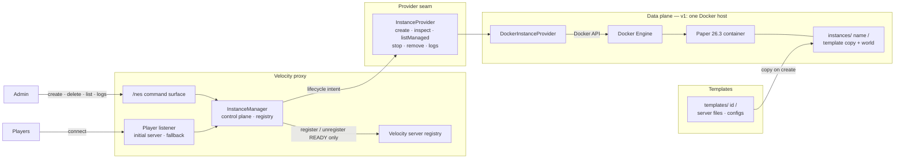
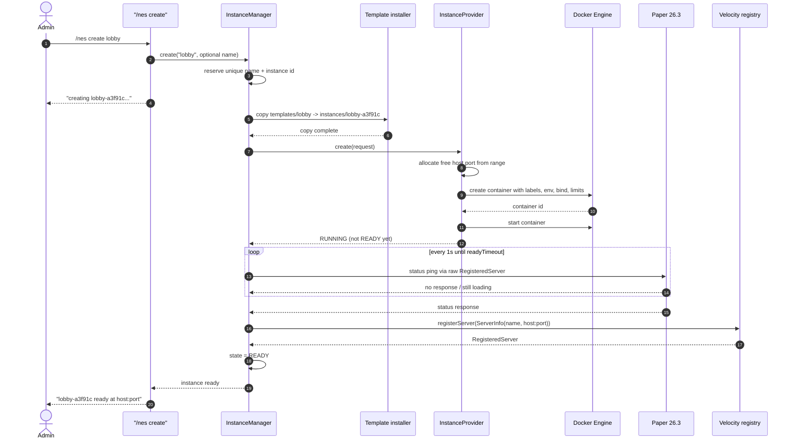
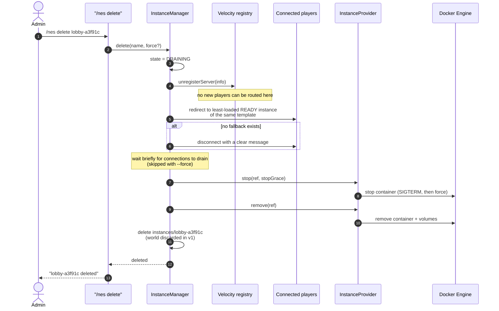
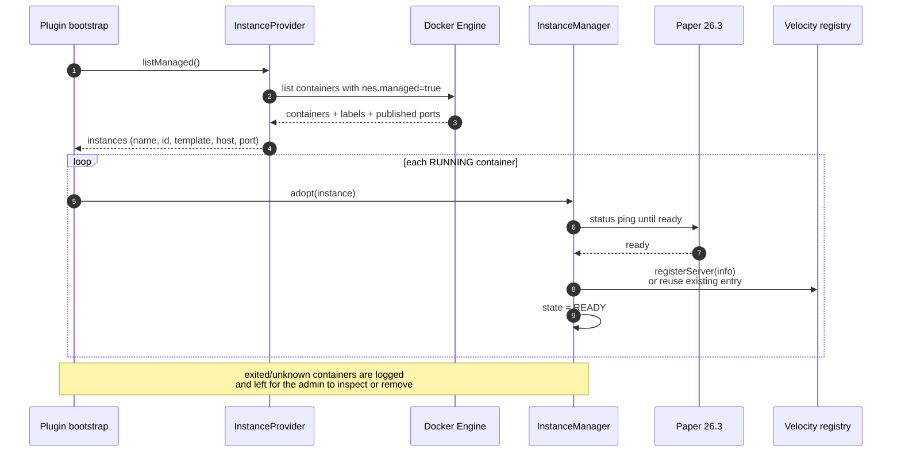
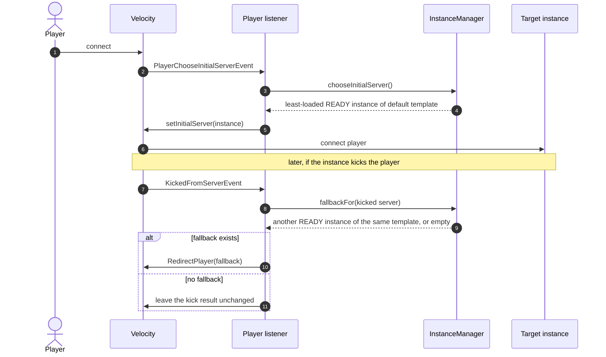
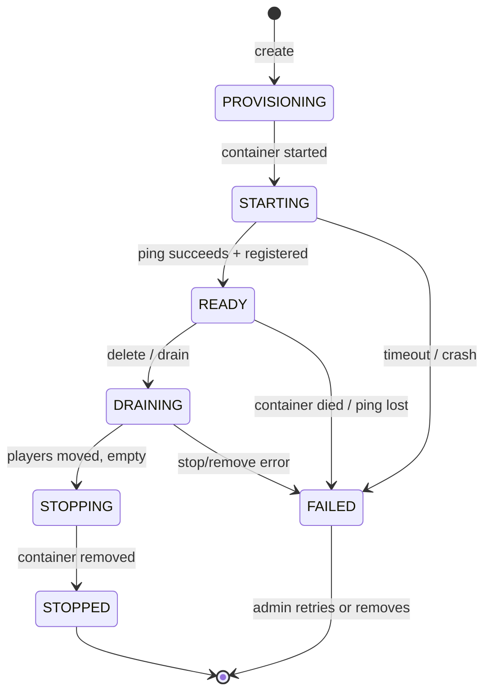

# NES — Service and Sequence Diagrams

> Companion to [`architecture.md`](./architecture.md). This page is intentionally
> limited to the v1 shape: one Velocity proxy, one Docker host, admin-triggered
> lifecycle.

## 1. Services and boundaries

**Boundary rules**

- `InstanceManager` never calls Docker. It talks to `InstanceProvider`.
- The provider never knows about Velocity, players or commands.
- `templates/` is configuration; `instances/` is disposable runtime data.
- Docker labels (`nes.managed`, `nes.instance-id`, `nes.name`, `nes.template`,
  `nes.owner`) are the recovery contract.

## 2. Create instance

Failure path: if the ping never succeeds, the manager stops/removes the container,
deletes `instances/<name>/`, and marks the instance `FAILED`.

## 3. Delete / drain

Ordering matters: **unregister first, then move players**, otherwise a fallback redirect
can put a player back on the server being removed.

## 4. Proxy restart / adoption

This is why v1 does not need a database: the proxy rebuilds its registry from Docker
labels and published ports.

## 5. Player routing

## 6. State at a glance

